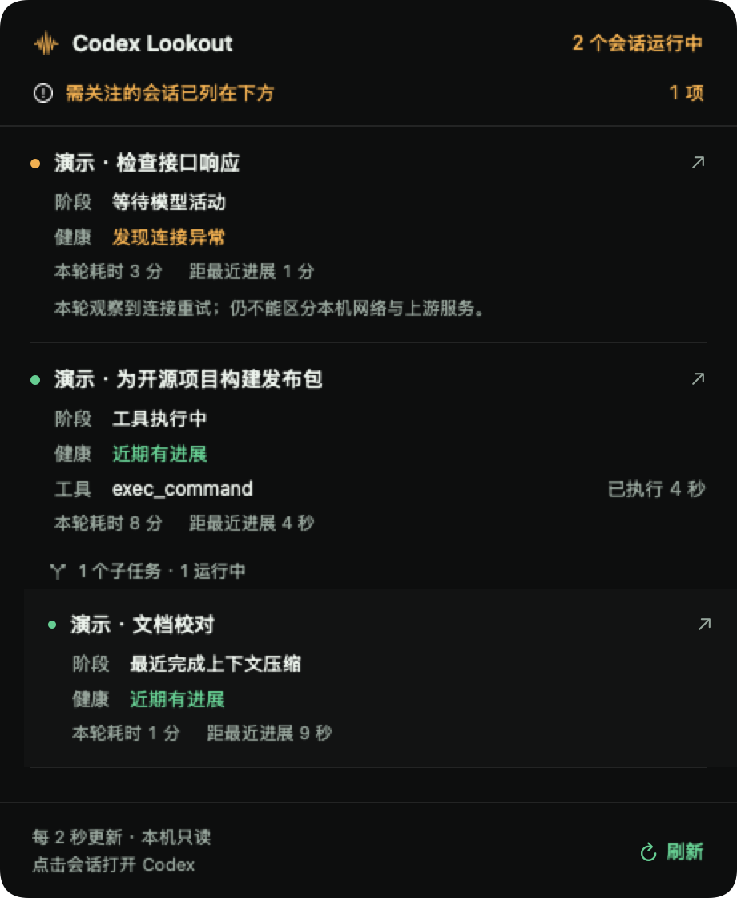

# Codex Lookout

**Know which Codex sessions are still working.**

Codex Lookout is a small macOS companion that puts session health at the top of your screen. Hover over the notch or top-center indicator to see running conversations, their latest observed stage, time since progress, and issues that need attention. Click a session to return to Codex.

[简体中文](README.zh-CN.md) · [How signals work](docs/signal-evidence.md) · [Privacy](PRIVACY.md) · [Contributing](CONTRIBUTING.md)

Independent community project. Not affiliated with or endorsed by OpenAI.

<p align="center"></p>

Synthetic session data rendered with the native SwiftUI view.

## What you get

- **A native hover panel.** Running sessions, parent/child tasks, tool duration, and health explanations without opening a browser.
- **Stage and health shown separately.** Recent reasoning, output, tools, waiting, and context compaction are distinct from recent progress, connection errors, and uncertainty.
- **Honest silence detection.** Two minutes without visible progress asks you to check; it does not claim the model is stuck.
- **A menu-bar fallback and settings.** Choose the Codex data folder, refresh interval, task limit, display, title privacy, and optional launch at login.
- **Optional local web details.** Search, filter, inspect event types and token counters, or explore clearly labeled synthetic examples.
- **Local, read-only collection.** No account, API key, analytics, or network probes. No task interruption or Codex configuration changes.

The app interface is currently in Simplified Chinese. English and Chinese documentation are included.

## Install

Requires **Apple Silicon and macOS 13 or later**. Intel builds are not validated.

1. Download the macOS arm64 ZIP from [Releases](https://github.com/Kidz0419/codex-lookout/releases) when a build is available.
2. Extract it, move **Codex Lookout.app** to Applications, and open it.
3. Check the data folder in the first-run window. The default is `CODEX_HOME` when set, otherwise `~/.codex`.
4. Hover over the top-center indicator. Use the menu-bar icon to reach settings or quit.

Release builds bundle their Python runtime. End users do not need Python, Xcode, or a terminal. The default build is ad-hoc signed, **not Developer ID signed or notarized**; macOS may require explicit approval to open a downloaded build. Source building is also supported. Release readiness and remaining device checks are tracked in the [release checklist](docs/release-checklist.md).

The app uses the system-reported notch geometry and falls back to top-center placement. It does not use the camera or require camera/accessibility permission. Launch at login is off until you enable it.

## Read the panel

| Signal | Meaning |
| --- | --- |
| Stage | The latest supported observation: reasoning, assistant output, tool execution, waiting, or compaction. Completion records describe a recent event, not continuous current activity. |
| Recent progress | A recent reasoning/output event, successful tool activity, or compaction event was observed. It is not a guarantee of a healthy connection. |
| Needs attention | No visible progress for 120 seconds, an explicit current-turn connection error, or uncertain running state. Read the explanation before deciding what to do. |
| Time since progress | Error retries and token-counter updates do not reset this clock. |
| Running count | Active conversations grouped with their child tasks. Recent failed or uncertain sessions can remain visible without increasing the count. |
| Stale data | Collection is delayed or unavailable. The last snapshot may remain visible, but is not presented as live. |

Defaults: refresh every **2 seconds**, inspect the most recent **200 unarchived local tasks**. Settings allow 2/5/10 seconds and 100/200/500 tasks. Remote and cloud sessions are outside this version's coverage.

**What it cannot tell you:** completion percentage, ETA, live tokens/second from sparse counters, or whether a connection failure originated in your Wi-Fi, proxy, provider, or upstream service. Long reasoning and quiet tools can look silent. Codex's local database formats are internal and may change. See [signal evidence and limitations](docs/signal-evidence.md).

## Build from source

On an Apple Silicon Mac, install Xcode command-line tools and Python 3.9+ for the development collector, then run:

```sh
git clone https://github.com/Kidz0419/codex-lookout.git
cd codex-lookout
./native/build.sh
open 'dist/Codex Lookout.app'
```

The development build uses an installed Python runtime. To build the self-contained release, use a native arm64 Python 3.10+:

```sh
PULSE_BUILD_PYTHON=/path/to/python3 ./native/build.sh --release
python3 scripts/smoke-release.py 'dist/Codex Lookout.app'
./scripts/package-release.sh
```

This installs pinned build dependencies inside `native/.build/`, not globally. Output is `dist/releases/codex-lookout-0.1.0-macos-arm64.zip` with a SHA-256 file. See [building and signing](docs/building.md) for CI, optional notarization, and verification.

Run the tests with:

```sh
./scripts/test.sh
```

Tests use synthetic fixtures and isolated databases. They do not modify your Codex data.

## Optional web view

The native menu can open the local detail view. From source, Python 3.9+ is sufficient:

```sh
python3 launch.py
# Or choose a folder, port, and task limit:
python3 server.py --codex-home ~/.codex --port 4318 --limit 80
```

The web service listens only on `127.0.0.1`, defaults to 80 recent tasks, and samples every 3 seconds. Stop a terminal-launched service with Ctrl+C. The native app stops services it started itself when it quits; it does not stop independently started services.

## Privacy and removal

Lookout reads selected local session metadata and extracts safe event fields. It does not expose full prompts, reasoning text, tool arguments, tool output, authentication files, or compaction contents. **Session titles and project paths can still contain private information.** Hiding titles applies to the native UI; inspect the separate web view before sharing it. Details: [privacy](PRIVACY.md) and [security](SECURITY.md).

To uninstall, turn off launch at login if enabled, quit from the menu bar, then remove **Codex Lookout.app**. If you also started the web service in a terminal, stop it there. Removing Lookout does not remove Codex conversations. See [troubleshooting](docs/troubleshooting.md) for connection and display issues.

## Contribute

Bug reports, compatibility fixes, translations, and accessibility improvements are welcome. Start with [CONTRIBUTING.md](CONTRIBUTING.md); share synthetic examples instead of private session files. The project is licensed under [MIT](LICENSE). Bundled runtime components retain their own licenses.
